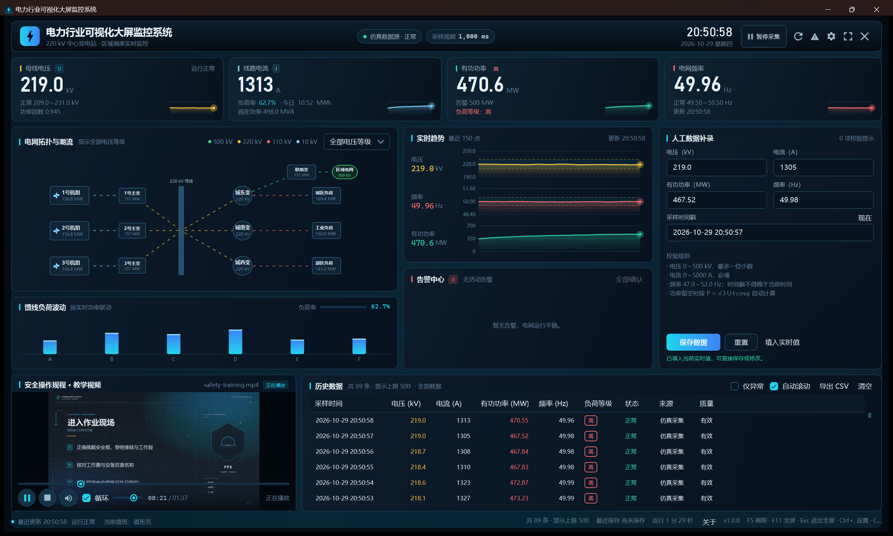

# PowerMonitorDashboard · 电力行业可视化大屏监控系统

基于 **WPF / .NET 10** 的电力监控大屏教学项目：实时采集（内置电网仿真）、电网单线拓扑、趋势分析、数据校验、告警闭环、安全教学视频与动画效果，按 MVVM 分层实现，并配有完整技术文档与单元测试。



## 功能特性

- **实时监控大屏**：顶部四张 KPI 卡片（电压 / 电流 / 有功功率 / 频率）与趋势曲线，每秒刷新，支持暂停/恢复与手动刷新。
- **电网拓扑（Canvas）**：发电机组、主变、母线、变电站、负荷单线图；按 110/220/500/10 kV 分色，可切换电压等级高亮；虚线流动动画模拟潮流方向；设备悬停显示 ToolTip 详情。
- **数据绑定与校验**：`PowerReading` 实现 `INotifyPropertyChanged`；录入表单使用自定义 `ValidationRule` 实时红框提示；电压 0～500 kV（最多一位小数）、电流 0～5000 A、频率 47.0～52.0 Hz、时间戳不得晚于当前时间；功率留空按 P = √3·U·I·cosφ 自动计算，并提供跨字段一致性提示。
- **值转换器**：功率值转换为“高 / 中 / 低”文本并按等级着色；运行状态、告警级别同样由转换器驱动配色。
- **历史数据**：`ObservableCollection` + `DataGrid`，异常筛选、自动滚动、CSV 导出、清空；退出时自动保存最近 5000 条快照。
- **告警闭环**：带回差（hysteresis）的告警状态机，支持产生 / 升级 / 恢复 / 确认，避免阈值抖动引发告警风暴；告警记录可导出。
- **安全教学视频**：`MediaElement` + 自定义控制栏，播放 / 暂停 / 停止 / 静音 / 音量 / 进度拖动，默认循环播放；加载旋转动画与失败重试；播放时背景颜色缓慢循环渐变。
- **动画效果**：背景 `ColorAnimation`、馈线负荷关键帧柱状动画（幅度随实时功率联动）、预警图标缩放与旋转、视频缓冲旋转指示。
- **系统设置**：采样周期、历史容量、阈值、视频路径等在线调整，立即生效并写入 `%LOCALAPPDATA%`。
- **工程化**：分层架构、依赖注入式组合根、结构化日志、全局异常处理、单实例运行、键盘快捷键、158 个单元测试。

## 技术栈

| 类别 | 选型 |
| --- | --- |
| 运行时 | .NET 10（`net10.0-windows`） |
| UI 框架 | WPF（XAML + 代码后置仅承担视图职责） |
| 架构模式 | MVVM（自实现 `ObservableObject` / `RelayCommand`） |
| 图表 | 基于 `DrawingContext` 自绘 `TrendChart` / `LoadBars`，无第三方图表依赖 |
| 数据 | 内置电网仿真器（可替换为 Modbus / OPC UA） |
| 测试 | xUnit（Core 113 + App 45） |
| 素材 | Python + Pillow + ffmpeg 生成教学视频、图标与文档插图 |

> 运行时零第三方 NuGet 依赖，便于离线部署与教学演示。

## 项目结构

```
PowerMonitorDashboard/
├─ PowerMonitorDashboard.sln
├─ Directory.Build.props          # 统一编译选项
├─ src/
│  ├─ PowerMonitorDashboard.Core/ # 领域层：模型、校验、告警、仿真、导出（无 UI 依赖）
│  └─ PowerMonitorDashboard.App/  # WPF 应用：视图、视图模型、基础设施、主题
├─ tests/
│  ├─ PowerMonitorDashboard.Core.Tests/
│  └─ PowerMonitorDashboard.App.Tests/
├─ docs/                          # 技术文档（架构、功能、数据模型、测试、构建）
├─ tools/media/                   # 视频 / 图标 / 文档插图生成脚本
└─ PowerMonitorDashboard.sln
```

## 快速开始

环境要求：Windows 10/11、[.NET 10 SDK](https://dotnet.microsoft.com/download)。

```powershell
# 还原并构建
dotnet build PowerMonitorDashboard.sln -c Release

# 运行
dotnet run --project src/PowerMonitorDashboard.App -c Release

# 运行全部单元测试
dotnet test PowerMonitorDashboard.sln -c Release
```

也可以使用一键脚本：

```powershell
./build.ps1            # 还原 + 构建 + 测试
./build.ps1 -Publish   # 额外发布到 artifacts/publish
```

发布后的可执行文件位于 `artifacts/publish/PowerMonitorDashboard.exe`，`Assets` 目录需与可执行文件同级的相对路径保持一致（发布脚本会自动复制）。

## 数据与配置

| 内容 | 位置 |
| --- | --- |
| 设置 | `%LOCALAPPDATA%\PowerMonitorDashboard\settings.json` |
| 历史快照 | `%LOCALAPPDATA%\PowerMonitorDashboard\history.json` |
| 日志 | `%LOCALAPPDATA%\PowerMonitorDashboard\logs\app-yyyyMMdd.log` |
| 导出 | 由“导出 CSV”对话框选择，默认目录为 `%LOCALAPPDATA%\PowerMonitorDashboard\exports` |

配置文件损坏或缺失时程序会自动回退到默认设置，并在日志中记录原因。

## 操作入口

| 操作 | 入口 |
| --- | --- |
| 刷新一条实时数据 | `F5` 或顶栏刷新按钮 |
| 暂停 / 恢复采集 | 顶栏按钮 |
| 故障演练（注入扰动） | 顶栏警告按钮，循环注入频率上扰 / 电压暂降 / 负荷冲击 / 频率下扰 |
| 全屏 / 退出全屏 | `F11` / `Esc` |
| 设置 | `Ctrl+,` 或齿轮按钮 |
| 导出历史 | `Ctrl+E` 或“导出 CSV” |
| 退出 | `Ctrl+Q` |
| 数据补录 | 右侧“人工数据补录”表单，支持“填入实时值”和“现在”快捷操作 |

## 文档

- [架构设计](docs/architecture.md)
- [功能规格与作业要求对照](docs/functional-spec.md)
- [数据模型与校验规则](docs/data-model.md)
- [界面设计规范](docs/ui-guidelines.md)
- [构建、运行与部署](docs/build-and-run.md)
- [测试说明](docs/testing.md)
- [素材生成流水线](docs/media-pipeline.md)
- [架构决策记录](docs/adr/0001-layered-architecture.md)

## 说明

本项目为 Windows 程序设计课程结课作业。数据源为内置电网仿真器，所有数值均由物理模型生成，不连接真实电网；教学视频为配套的《电力安全操作规程》短片（1280×720，H.264/AAC，约 97 秒），仅用于演示 `MediaElement` 的完整控制流程。
