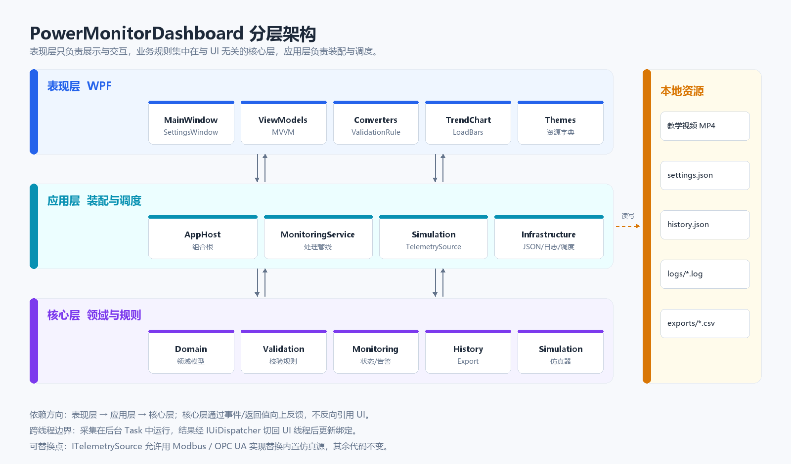
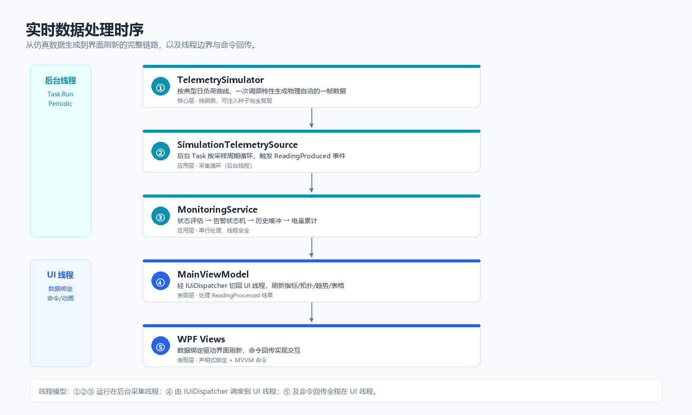

# 架构设计

## 1. 设计目标

1. **界面与业务解耦**：大屏的视觉呈现与电力业务规则（阈值、校验、告警）分别演进，互不牵制。
2. **真实感优先**：数据不是随机数，而是由带日负荷曲线、一次调频/调压特性的仿真模型产生，字段之间满足功率方程。
3. **可测试**：核心规则全部为纯函数或无 UI 依赖的类，单元测试可直接覆盖。
4. **可替换**：数据源、存储、对话框、时钟、调度器均以接口注入，便于替换为真实 SCADA 接入或测试替身。

## 2. 分层结构



| 层 | 项目 | 职责 | 依赖 |
| --- | --- | --- | --- |
| 表现层 | `PowerMonitorDashboard.App`（Views / ViewModels / Controls / Themes） | XAML 布局、数据绑定、动画、视频控制、值转换器 | 应用层、核心层 |
| 应用层 | `PowerMonitorDashboard.App`（Services / Infrastructure / AppHost） | 组合根、采集循环、监控管线、持久化、日志、UI 调度 | 核心层 |
| 核心层 | `PowerMonitorDashboard.Core` | 领域模型、校验规则、告警状态机、历史缓冲、仿真器、CSV 导出 | 仅 BCL（`System.ComponentModel` / `System.Text.Json`） |

依赖方向严格单向：`App → Core`，核心层不引用任何 WPF 类型。视图模型依赖 `IAppLogger`、`IClock`、`IUiDispatcher` 等抽象，保证在无界面环境下也可测试。

## 3. 运行时装配

组合根为 `AppHost`，在 `App.OnStartup` 中创建并启动：

```
App.OnStartup
  └─ AppHost.Start()
       ├─ AppPaths / FileLogger / JsonSettingsStore / JsonHistoryStore
       ├─ TelemetrySimulator → SimulationTelemetrySource
       ├─ MonitoringService（阈值、历史容量、时钟、日志）
       ├─ MainViewModel（子视图模型 + 命令 + 定时器）
       ├─ MainWindow（DataContext = MainViewModel）
       └─ 订阅 source.ReadingProduced → service.Accept(reading)
```

退出时 `App.OnExit → AppHost.Dispose()` 依次停止采集、保存历史、刷新日志并释放单实例互斥量。

## 4. 数据流与线程模型



- **采集线程**：`SimulationTelemetrySource` 使用 `Task.Run` + `Task.Delay` 循环，按设置中的采样周期调用仿真器；`TelemetrySimulator` 由锁保护，支持“故障演练”在任意线程注入扰动。
- **处理管线**：`MonitoringService.Accept` 在采集线程执行，完成状态评估、告警状态机、历史入队、电量积分，并返回不可变的 `ProcessingResult`。
- **UI 线程**：`MainViewModel` 通过 `IUiDispatcher.Post` 把结果送回 UI 线程，依次更新 KPI、拓扑、趋势、表格与告警面板；所有 `ObservableCollection` 操作都发生在 UI 线程。
- **命令方向**：按钮 / 快捷键 → `RelayCommand` → 视图模型 → 数据源或服务，与数据流方向分离。

## 5. 关键模块

### 5.1 领域模型

- `PowerReading`：实现 `INotifyPropertyChanged` 的实时数据对象，`UpdateFrom` 就地更新以保持绑定对象稳定；历史表保存 `Clone()` 快照。
- `PowerThresholds`：不可变记录，集中定义电压/频率/电流/功率判据与负荷分级，支持在线校验与序列化。
- `Alarm`：具有 `Active → Acknowledged → Cleared` 生命周期，数值与描述随工况刷新。

### 5.2 校验

校验规则以纯函数形式集中在 `ReadingValidator`：

- 电压 0～500 kV，最多一位小数；
- 电流 0～5000 A，必填；
- 频率 47.0～52.0 Hz；
- 时间戳格式 `yyyy-MM-dd HH:mm:ss`（兼容若干变体），不得晚于当前时间；
- 功率可留空，留空时按 `P = √3·U·I·cosφ` 自动计算；
- 跨字段一致性提示（偏差超过 10% 且大于 5 MW 时给出非阻断警告）。

WPF 的 `ValidationRule` 只是 Core 校验器的适配层，因此“逐字段红框”和“保存前整体校验”使用同一套规则。

### 5.3 告警状态机

`AlarmStateMachine` 以 `AlarmKind` 为键维护活动告警，输出 `Raised / Escalated / Updated / Cleared` 四类变更。每个判据都有回差：

| 告警 | 触发 | 清除 | 回差 |
| --- | --- | --- | --- |
| 频率高/低 | 越出 49.5～50.5 Hz | 回到阈值内 0.05 Hz | 0.05 Hz |
| 电压高/低 | 越出 ±5% 额定值 | 回到阈值内 0.5% 额定值 | 1.1 kV（220 kV） |
| 电流越限 | > 1350 A | < 1336.5 A | 1% |
| 功率越限 | > 500 MW | < 495 MW | 1% |

超过严重阈值时告警升级为 `Critical`，但不会重复产生新告警。

### 5.4 仿真器

`TelemetrySimulator` 的核心约束：

- 负荷跟随典型日曲线（控制点 + 余弦插值），一阶惯性时间常数 30 s；
- 频率具备一次调频特性（负荷升高频率略降），并按 OU 过程回归额定值；
- 电压随负荷轻微下降，叠加慢漂移与噪声；
- 电流由功率反算，最终功率再由 **取整后的** U、I、cosφ 计算，确保三个字段严格自洽；
- 支持注入频率上扰/下扰、电压暂降、负荷冲击，扰动按指数衰减。

### 5.5 图表控件

`TrendChart` 与 `LoadBars` 直接重写 `OnRender`，用 `DrawingContext` 绘制：

- 无第三方图表库、无 XAML 元素树膨胀；
- 依赖属性变化触发 `AffectsRender`，只重绘自身；
- 支持阈值参考线、渐变填充、末端高亮、空数据提示；
- `LoadBars` 用 `DoubleAnimationUsingKeyFrames` 驱动相位，6 根柱子按相位差绘制，幅度与实时负荷率联动。

## 6. 错误处理与可观测性

- 全局 `DispatcherUnhandledException` / `AppDomain.UnhandledException` / `TaskScheduler.UnobservedTaskException` 统一记录日志并提示用户。
- `FileLogger` 按天滚动、逐行刷新，异常退出也不丢关键日志。
- 配置与历史写入采用“临时文件 + 原子替换”，损坏文件回退默认值并记录警告。
- 视频加载失败、文件缺失、解码失败均有明确提示与“重新加载”入口。
- 采集停顿超过 4 个采样周期时，顶栏连接状态切换为“数据延迟”。

## 7. 扩展点

| 扩展点 | 当前实现 | 替换方式 |
| --- | --- | --- |
| `ITelemetrySource` | 内置仿真源 | 实现 Modbus TCP / OPC UA 客户端，在 `AppHost` 注册 |
| `IAppLogger` | 文件日志 | 接入 Serilog / ETW |
| `IFileDialogService` / `IUserDialogService` | WPF 对话框 | 测试替身或自动化驱动 |
| `IUiDispatcher` / `IUiScheduler` | WPF Dispatcher | 单元测试使用同步实现 |
| `PowerThresholds` | JSON 配置 | 由后台下发或按站点配置 |

## 8. 性能取舍

- 冻结画刷（`Freezable.Freeze`）避免跨线程与变更通知开销。
- 历史表启用行虚拟化，容量上限默认 500 行，缓冲区 5000 条。
- 趋势图只保留 150 个采样点，每秒一次重绘。
- 拓扑与图表使用固定设计坐标 + `Viewbox` 缩放，避免布局抖动。
- 采集周期可配置，最低 200 ms，默认 1 s。
